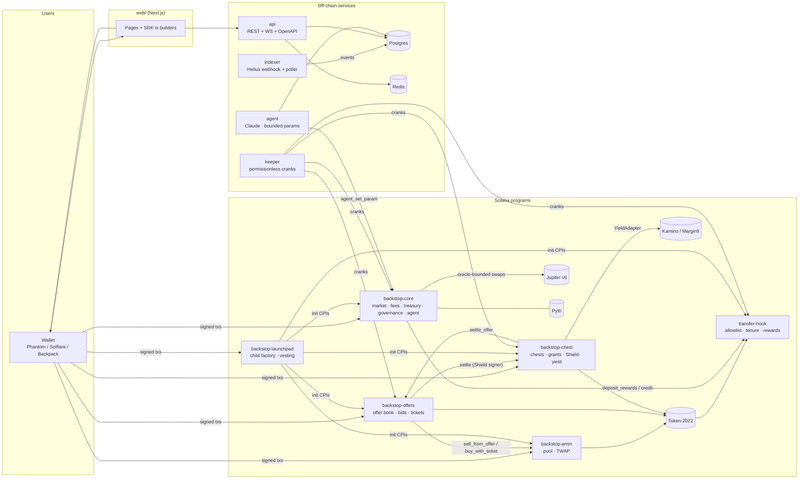
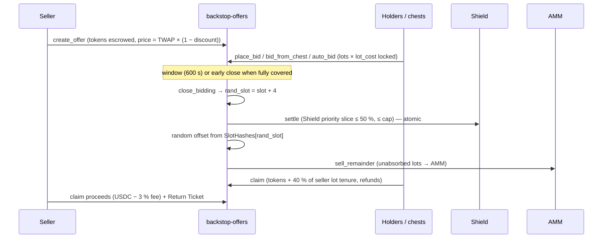
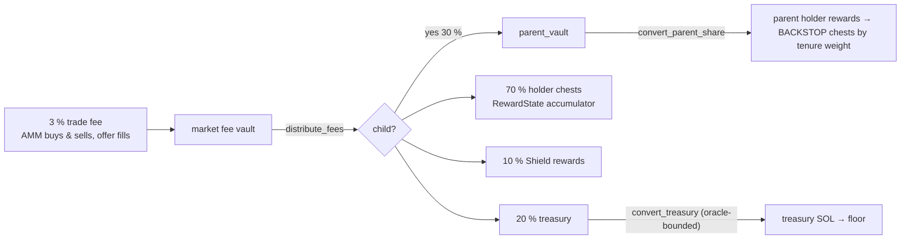

# Architecture

BACKSTOP is a Token-2022 token whose every sell above a minimum size becomes a
time-limited, discounted offer to existing holders. Holders absorb offers with
USDC from per-wallet chests funded by trading fees; a pooled Shield takes a
priority slice; the unabsorbed remainder is sold to a protocol-owned AMM.

## Components

## Program responsibilities and CPI depth

| Program | Owns | Calls |
|---|---|---|
| `transfer-hook` | `HookConfig`, `Holder` (tenure + reward checkpoint), `RewardState` (epoch ring) | — (leaf) |
| `backstop-core` | `Market` (params, roles, fee totals), `Treasury`, `AgentAuthority`, `QueuedAction` | hook (reward deposits, credits), swap program (Jupiter / mock) |
| `backstop-amm` | `Pool` (reserves, 96-entry TWAP ring, direct-sell cap) | Token-2022 (→ hook) |
| `backstop-offers` | `OfferBook`, `Offer`, `Bid`, `Ticket` | amm (remainder, ticket buys), chest (settlement via Shield signer), Token-2022 |
| `backstop-chest` | `ChestMarket`, `Chest`, `Grant`, `Shield`, `ShieldPosition` | offers (bids), yield adapter, Token-2022 |
| `backstop-launchpad` | `LaunchpadConfig`, `ChildLaunch` | hook, core, amm, offers, chest (initialisation only) |

Deepest path (remainder sale): `offers → amm → Token-2022 → hook` = 4 of the
5 allowed levels. This is why tenure/rewards live in the hook (D-010) and the
remainder sale is a separate instruction (D-041).

## Lifecycle of a sell

## Fees

## Off-chain services

| Service | Role | State | Can it move funds? |
|---|---|---|---|
| indexer | decode events from every program, idempotent declarative mutations, replay from any slot | Postgres | no |
| api | REST + WebSocket (`backstop:live` channel), OpenAPI at `/docs`, Redis cache, rate limit | Postgres, Redis | no |
| keeper | settle/remainder/claims, auto-absorb, fee distribution & swaps, rebalance, epochs, snapshots; audit log with pre/post state hashes | Postgres (`keeper_runs`) | only within on-chain bounds |
| agent | 24 h snapshot → Claude → bounded `agent_set_param`, governance proposals, narration (X feature-flagged) | Postgres (`agent_*`) | no (parameters only) |
| web | all user flows; builds transactions client-side with the SDK | — | no (user signs) |

See [accounts-and-seeds.md](accounts-and-seeds.md), [economic-spec.md](economic-spec.md),
[keeper-runbook.md](keeper-runbook.md), [incident-runbook.md](incident-runbook.md),
[agent.md](agent.md), [DEPLOYMENT.md](DEPLOYMENT.md), [audit-prep.md](audit-prep.md).
